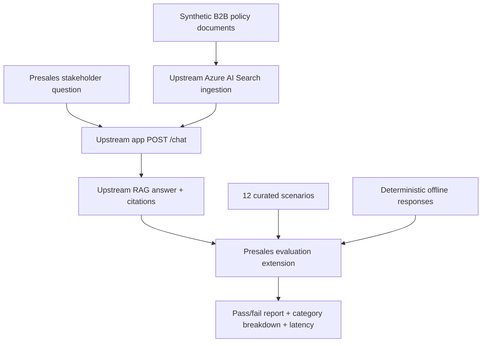

# B2B Presales RAG — Synthetic Evaluation Extension

**My contribution to this fork:** an independent, reproducible **solution-engineering scenario pack** designed to validate whether a document-grounded assistant can answer B2B presales questions, cite its sources, and avoid unsupported commercial and compliance promises.

> **Source attribution:** This repository is a fork of [Microsoft Azure Samples — azure-search-openai-demo](https://github.com/Azure-Samples/azure-search-openai-demo), released under MIT. The upstream project provides the full Azure RAG application, interface, retrieval, indexing, deployment infrastructure and general evaluation tooling. **I did not create those upstream components.** The original project and its license remain preserved. This directory contains my separate portfolio extension.

## Business problem

A potential customer asks a sales engineer questions such as:

- “Does your product synchronize with our CRM in real time?”
- “Which plan includes SAML single sign-on?”
- “Can you guarantee 99.99% availability?”
- “Can we run a proof of concept with live production data?”

A demo assistant should retrieve the relevant documentation, give a clear and evidence-based response, and *not invent missing certifications, pricing or SLAs*. This is a **solution-engineering** problem, not just a chat UX demonstration.

## Deliverables

| Component | Purpose |
| --- | --- |
| [Synthetic source documents](data/) | Fictional B2B policies in Markdown, staged as supported TXT files before Azure ingestion |
| [Evaluation scenarios](scenarios.json) | 12 hand-authored business questions with expected terms, citations and forbidden claims |
| [Offline response fixtures](fixtures/answers.jsonl) | Deterministic examples to test the evaluator without an LLM |
| [Evaluation engine](evaluate.py) | Validates answers, source references and absent unsupported phrases; optionally calls an Azure deployment |
| [Corpus staging tool](prepare_corpus.py) | Generates plain-text files in upstream's `data/` directory for documented ingestion support |
| [Unit tests](tests/) | Checks parsing, incorrect facts, citations, missing fixtures, staging safety, HTML escaping and URL protections |
| [HTML stakeholder dashboard](report_html.py) | Renders a static, privacy-conscious summary with category coverage and case outcomes |
| [GitHub Actions](../.github/workflows/presales-demo.yml) | Runs tests, corpus staging and offline replay on every relevant code change |

All business names, policies, prices and limits in this extension are **fictional**. No SAP assets, company data, customer records or proprietary prompt chains are used.

## Demonstration architecture



**Solid contribution boundary:** The synthetic corpus, rules, harness and tests in this folder are additions to the fork. The Azure RAG runtime in the rest of the repository is Microsoft's sample, not an original reimplementation.

## Quick start — zero Azure costs

Requires **Python 3.10+**. There are no third-party dependencies for this extension.

From the repository root:

```bash
python -m unittest discover -s presales_demo/tests -v
python -m presales_demo.prepare_corpus
python -m presales_demo.evaluate --mode fixtures
python -m presales_demo.evaluate --mode fixtures --report presales_demo_report.json
python -m presales_demo.report_html --input presales_demo_report.json --output presales_demo_report.html
```

Expected output for the included hand-authored replay cases:

```text
Mode: fixtures
Cases passed: 12/12
Pass rate (heuristic): 100%
```

This score merely shows that the synthetic reference responses satisfy the **rule-based checks**. It is **not a measured RAG model accuracy score**. No Azure service, live retrieval or LLM call is exercised by the fixture replay.

The optional JSON and static HTML reports show per-case pass/fail, category coverage, missing keywords/citations and latency without storing generated answers or auth tokens. The HTML renderer escapes any untrusted report values. Review the report before sharing it, especially when evaluating real user questions or remote endpoints.

## Real deployment experiment — requires Azure

1. Follow the official project's [getting started guide](../README.md#getting-started), [deployment documentation](../docs/azd.md) and [data ingestion guide](../docs/data_ingestion.md).
2. Create a **separate demonstration dataset/index**, then from the repo root run `python -m presales_demo.prepare_corpus` to stage four supported `data/01-product.txt`, `02-pricing.txt`, `03-security.txt`, `04-implementation.txt` files. The upstream manual ingestion documentation explicitly lists TXT (not Markdown) as supported. Run `./scripts/prepdocs.sh` (Linux/macOS) or `./scripts/prepdocs.ps1` (PowerShell) with a configured `azd` environment to ingest data. **Be aware that upstream ingestion also processes other files already under `data/`; isolate the dataset/index when measuring the presales pack.** The staging output is gitignored.
3. Test the upstream chat interface manually and check that it can cite your ingested documents.
4. Evaluate the non-streaming **`POST /chat`** endpoint:

```bash
python -m presales_demo.evaluate \
  --mode live \
  --url https://YOUR-DEPLOYMENT-ADDRESS \
  --report live-report.json
```

If the deployment expects bearer authentication, provide the token via an environment variable, **not** a command-line argument:

```bash
export PRESALES_BEARER_TOKEN="YOUR_AUTHORIZED_SHORT_LIVED_TOKEN"
python -m presales_demo.evaluate \
  --mode live \
  --url https://YOUR-DEPLOYMENT-ADDRESS \
  --token-env PRESALES_BEARER_TOKEN \
  --report live-report.json
```

Token acquisition depends on the upstream app's authentication configuration. This extension does not bypass application authentication. Local HTTP is allowed only for `localhost`, `127.0.0.1` or `::1`; all remote calls require HTTPS. The harness uses a bounded request timeout and a 2 MB response size limit.

**No Azure resources were provisioned and no live Azure evaluation results are claimed in this repository.** Hosting/ingestion requires Azure permissions and may incur charges; see upstream [cost guidance](../README.md#cost-estimation).

## Evaluation methodology

Each scenario defines:

- **Required facts:** a set of case-insensitive keyword alternatives; all groups must match.
- **Required document citations:** filenames that must appear as explicit Markdown bracket citations (e.g. `[02-pricing.txt]`).
- **Forbidden claims:** phrases that indicate an unsupported promise (e.g. a guaranteed uptime percentage).
- **Abstention expectation:** cases requiring explicit uncertainty, such as a certification not established in the documents.
- **Category:** product-fit, commercial, security, operations, solution engineering or unsupported claims.

A case passes **only** when every required keyword group and expected citation is present and no forbidden phrase is found. The overall pass rate is the number of passing cases divided by all cases. Mean observed latency is emitted for live calls, never fixture replay.

This is a **deliberately transparent, low-cost heuristic regression suite**. It does *not* prove semantic grounding, actual source verification, safe production operation, regulatory compliance or hallucination-free responses. Citation strings can be fabricated by an LLM. A production-grade extension should compare citations against retrieved document IDs, review false positives, use human-labeled evaluation samples and add independent semantic judges.

### Testing matrix

| Situation | Expected harness behavior |
| --- | --- |
| Correct answer with required citations | Pass |
| Correct facts but no `[source.txt]` citation | Fail |
| Wrong pricing or limits | Fail |
| Unsupported guarantee | Fail |
| Missing fixture or malformed schema | Fail closed |
| HTTP to a non-local remote host | Rejected before sending a request |
| Live endpoint unavailable | Fail corresponding cases without leaking token |
| Offline fixtures only | Run without Azure access or third-party packages |

## Sales-engineering demonstration script

Use the upstream UI after ingestion, then compare its behavior against these sample questions:

1. **Product qualification:** “Can MeridianOps update CRM accounts in real time?” — Correctly explain hourly refresh and lack of write-back.
2. **Commercial discovery:** “How much is Growth and how many users?” — Cite the fictional pricing page, avoid invented discounts.
3. **Security qualification:** “Does Starter include SAML SSO?” — Cite Enterprise-only support.
4. **Responsible objection handling:** “Is MeridianOps SOC 2 Type II certified?” — Do *not* invent certification; route to appropriate security validation.

The purpose is to explain to stakeholders **what can be trusted, what cannot yet be confirmed, and what needs human review**.

## Reproducible development workflow

- Write/adjust fictional product-policy Markdown documents, then stage their TXT ingestion copies with `python -m presales_demo.prepare_corpus`.
- Define expectation cases in `scenarios.json`.
- Update fixture responses as demonstrations of *expected* reasoning, not proof of model output.
- Run `python -m unittest discover -s presales_demo/tests -v`.
- Run fixture replay.
- In a deployed test environment, ingest documents, run the live suite and manually review case outcomes, citation evidence and system costs.
- Compare iterations using the same cases; never compare fixture scores against live model scores as equivalent measurements.

## Security, privacy and limitations

- This extension must **not** be used to ingest restricted company files or real customer data.
- No business policies here are real commercial commitments.
- The live API client expects JSON with an `output_text` string from the upstream `/chat` endpoint. Upstream protocol changes may require adapter updates.
- Its basic Markdown citation parser recognizes `[document.txt]`, `[document.md]` or `[document.pdf#page=1]`. If a deployment emits another citation syntax, review and adapt the parser before interpreting the results.
- No production guardrails, monitoring service, access-control implementation or CI-based Azure deployment are provided by this extension. Use the upstream production/security guidance before considering real-world use.
- **Auth tokens are not included in fixture data, reports, GitHub Actions or logs.** Never commit secrets.

## Roadmap

- Add source-ID-based evidence validation and explicit citation provenance.
- Add human-rated correctness sets and optional groundedness judges.
- Record model, search settings, token usage and cost for comparable *live* runs.
- Add a small visual evaluation dashboard and approval workflow for demo responses.
- Add CI against a dedicated temporary Azure test environment when a budget and credentials are available.

## Credit and scope

- **Upstream author:** [Azure Samples / Microsoft](https://github.com/Azure-Samples/azure-search-openai-demo). The fork keeps the upstream [MIT license](../LICENSE), infrastructure, retrieval pipeline, app and original docs.
- **Portfolio extension:** synthetic MeridianOps scenario corpus, scenario definitions, regression evaluator, Python tests, CI automation and this documentation.

This contribution is intentionally scoped so it can be inspected, run and assessed **without pretending the entire forked RAG platform was developed from scratch**.
